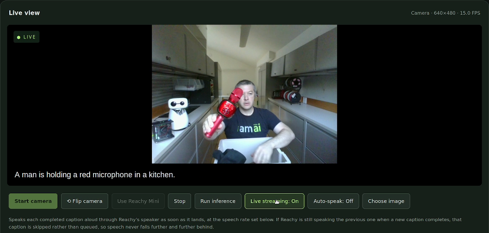
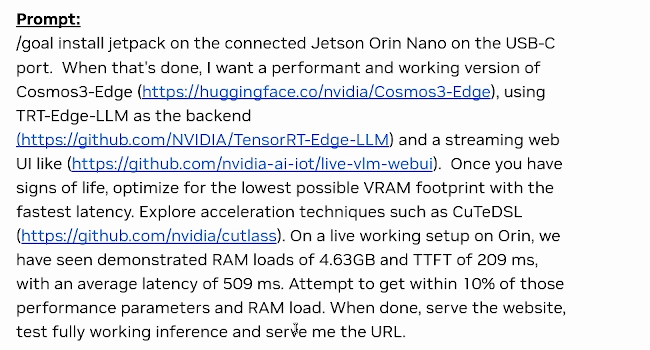
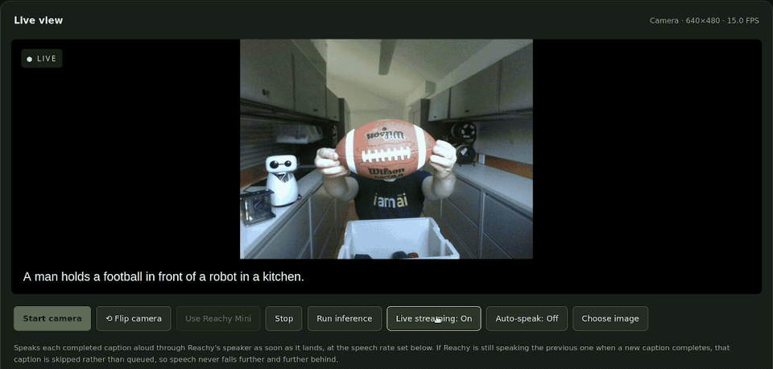
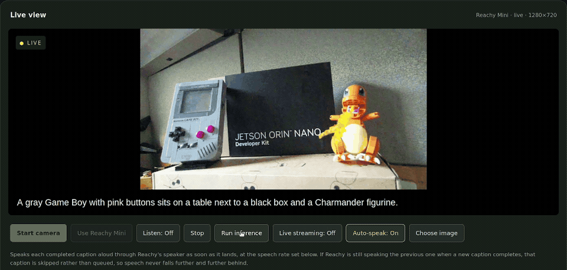

# Live Vision With Cosmos3-Edge on Jetson



Run a browser camera through **NVIDIA Cosmos3-Edge on a Jetson Orin Nano 8 GB** and watch captions respond to the scene in front of you. This repository brings together the Live Vision interface, local INT4 inference and an optional Reachy Mini extension, with an Astra workflow for building it and a packaged runtime in preparation.

Alex Sotelo presented the original demo during [**A New Way to Build Edge AI: Agentic Development on NVIDIA Jetson**](https://www.youtube.com/live/OF_ryVZmB3w?t=1927) on **September 30, 2026, at 9:00 a.m. Pacific**. One initial agentic goal produced the first working FP16 baseline; optimization, INT4 integration, interface improvements and accuracy fixes followed. The images here come from Alex's October 2 follow-up demo. See [the build story and chapter guide](docs/demo-history.md).

**Choose your route:** [Build with Astra](#build-with-astra) · [Run the packaged demo](#run-the-packaged-demo)

[Prerequisites](#what-you-need) · [First caption](#try-your-first-caption) · [Reachy Mini](#optional-reachy-mini) · [Inference API](#use-the-inference-api) · [Troubleshooting](docs/troubleshooting.md) · [Updates](#updates-and-contributions)

## What you need

| Item | Supported starting point |
|---|---|
| Jetson | Orin Nano Super developer kit with 8 GB RAM, power supply, and a booting **JetPack 7.2.1 / L4T 39.2.1** installation. |
| Storage | A **64 GB or larger SD card** is recommended for the source build. Setup checks available space for dependencies and intermediate model files. |
| Network | Internet access for installation; a trusted local network between the Jetson and your browser. Start with Ethernet. |
| Setup computer | Git, Bash, SSH, SCP and tar. The default source build runs on the Jetson; your computer does not need CUDA, TensorRT or a GPU. |
| Camera | A webcam or smartphone camera accessible to a browser over HTTPS. An optional Reachy Mini supplies another camera through its bridge. |

Keep a compatible JetPack installation. If the board needs an operating system first, follow the [supported Mac SD preparation guide](docs/jetpack-sd-mac.md) and [first-boot checks](docs/first-boot-recovery.md), then return here.

The source installer provides **CUDA 13.2**, uses **TensorRT 10.16.2.10** for matching engines, and builds the pinned **TensorRT-Edge-LLM 0.11.0** revision. Engines from another SDK or TensorRT build require rebuilding and inference validation. The [runtime compatibility record](container/runtime-spec.json) lists exact identities. Model inference runs locally on the Jetson; a coding agent may use a remote service while helping you build it.

## Build with Astra

Give the agent an outcome, the repository and a way to prove it worked. In the demonstrated Astra/Codex workflow, `/goal` starts the goal-directed task; other tools may use a different command.

Open this repository in your Astra workspace and adapt the following goal to your device:

```text
/goal Help me recreate the Live Vision demo on my Jetson Orin Nano 8 GB using
https://github.com/NVIDIA-AI-IOT/live-vision-cosmos-demo.
Read the repository instructions and inspect my device before changing it.
Reuse a compatible JetPack installation; ask before any destructive flashing.
Use the pinned Cosmos3-Edge model and TensorRT-Edge-LLM configuration to build
a working local INT4 inference setup and an HTTPS browser-camera interface.
Keep Reachy Mini optional. Ask for human help when credentials, physical steps,
or a blocking decision are required.
Verify actual INT4, coherent text, known-image captions, changing camera frames,
restart behavior, and a ten-minute camera smoke run with recorded memory use.
Report the measured timing/resource results and limitations, then give me the
working URL. Establish this baseline before proposing further optimization.
```

Let the agent inspect the board, read [AGENTS.md](AGENTS.md), explain the setup and run the installer. Enter credentials in its local terminal when needed. Once the UI appears, use [the first-caption walkthrough](#try-your-first-caption) together: verify the words match known scenes, change what the camera sees and check that captions change too. A successful build or green readiness response alone cannot establish accuracy or INT4 precision.



*Original goal shown at 03:25 in the October follow-up. Its performance numbers were historical targets, not guarantees for this package. [Read the selectable transcript and context](docs/demo-history.md#the-original-goal).*

After the baseline works, ask the agent to measure the same images, prompts and settings before changing anything. The [source guide](docs/source-installation.md) explains engine rebuilding and the optional Linux-host export path.

## Run the packaged demo

**The prebuilt download is still in preparation.** This candidate includes the container build and launcher, but no published runtime image or engine bundle. The [packaged runtime guide](container/README.md) describes the required artifacts and current validation status.

To run the demo today, use the automated **source build** below. It downloads the pinned model, builds INT4 inference on the Jetson, configures HTTPS and starts the services. Budget well over an hour for an Orin Nano build; setup resumes completed stages after an interruption.

### 1. Connect your Jetson

Complete first boot, confirm SSH access to the intended board and keep it connected to Ethernet. Replace `jetson-user@orin-ip` below with its verified account and address. A Reachy Mini is optional.

### 2. Start setup from your computer

For this preparation branch:

```bash
git clone --branch feat/live-vision-cosmos-demo https://github.com/NVIDIA-AI-IOT/live-vision-cosmos-demo.git
cd live-vision-cosmos-demo
bash scripts/bootstrap.sh jetson-user@orin-ip
```

Enter the Jetson's SSH and sudo passwords when prompted. The installer offers Reachy discovery, a manual address or **Skip**; choosing Skip still gives you browser-camera captions. No Hugging Face token is required for the pinned model revision. For source-install details and recovery, see [the installation guide](docs/source-installation.md#advanced-source-installation).

### 3. Open Live Vision

Open the HTTPS URL printed by setup, normally `https://<orin-ip>:8443/`, on the computer or phone whose camera you want to use. Trust the certificate from your own Jetson, grant camera permission and continue below.

## Try your first caption

Click **Start camera**. Leave **Live streaming: On**, hold an object steadily in view and read the caption as it arrives. Try the follow-up demo's sequence: a football, a cap, then a microphone. Move the object out of view or replace it and confirm that the next caption follows the new scene.



*October follow-up, 00:38–00:46, at original playback speed. Captions are the recorded model output; selected examples are not an accuracy benchmark.*

Use **Choose image** for a repeatable test or turn live streaming off and click **Run inference** for one request. If a description is wrong, improve the framing, hold still and retry with a known image. Record persistent errors rather than treating fluent text as proof that the model saw the scene correctly. The [troubleshooting guide](docs/troubleshooting.md) covers camera permissions, setup recovery and caption failures.

## Optional Reachy Mini

With the source installation, open **Reachy Mini setup** to discover or enter a verified robot address, then select **Use Reachy Mini**. The setup checks the robot before saving it and leaves model inference running. [Reachy setup](docs/reachy-setup.md) explains discovery, changing robots and skipping this extension.



*October follow-up, 02:07–02:15. The GIF is silent; a [still image](docs/media/reachy-caption-02m14s.png) is also available.*

The source installation prepares Piper speech and the camera bridge. After connecting your robot, try **Auto-speak** to hear captions. The current fixed-engine container does **not** include robot camera bridging or Piper speech; use the source path for those features. No Home Assistant installation is required.

## Use the inference API

Live Vision preserves `/health/ready` and `/v1/chat/completions`. Its UI proxy accepts one JPEG and one text prompt per streaming request. With `scene.jpg` in your current directory, run this example **on the Jetson** against the local UI listener after source setup:

```bash
curl http://127.0.0.1:8091/health/ready

python3 - <<'PY' | curl --no-buffer \
  http://127.0.0.1:8091/v1/chat/completions \
  -H 'Content-Type: application/json' --data-binary @-
import base64, json
from pathlib import Path
image = base64.b64encode(Path('scene.jpg').read_bytes()).decode('ascii')
print(json.dumps({
    'model': 'nvidia/Cosmos3-Edge', 'stream': True,
    'temperature': 0, 'max_tokens': 64,
    'messages': [{'role': 'user', 'content': [
        {'type': 'text', 'text': 'Describe the main object in this image.'},
        {'type': 'image_url', 'image_url': {'url': 'data:image/jpeg;base64,' + image}}
    ]}]
}))
PY
```

Use a small JPEG so the encoded JSON request stays below 2 MiB. Read the returned text as well as the readiness result. For access from another computer, use HTTPS on port 8443 with a certificate matching the Jetson's hostname or address. For container deployment, see [the runtime API guide](container/README.md#inference-api).

## Updates and contributions

The current candidate moves to TensorRT-Edge-LLM 0.11.0 and includes a guarded visual-export correction. Source-engine checks are recorded in [the upgrade assessment](docs/edgellm-0.11-upgrade.md); final packaged artifacts still need hardware validation. Follow [CHANGELOG.md](CHANGELOG.md) for changes.

For deeper work, start with the [source and engineering guide](docs/source-installation.md), [troubleshooting](docs/troubleshooting.md) or [demo history](docs/demo-history.md). Contributions use the process and DCO sign-off in [CONTRIBUTING.md](CONTRIBUTING.md).

The application's code is licensed under [Apache-2.0](LICENSE.md). The copied Pollen Robotics files in [`reachy/reachy_stream/`](reachy/reachy_stream/) retain their [Apache-2.0 license and copyright](reachy/reachy_stream/LICENSE). [NOTICE.md](NOTICE.md) records third-party and media attribution; model weights, engines and other dependencies have their own terms and are not included here. [SOURCE.json](SOURCE.json) records the imported source provenance.
