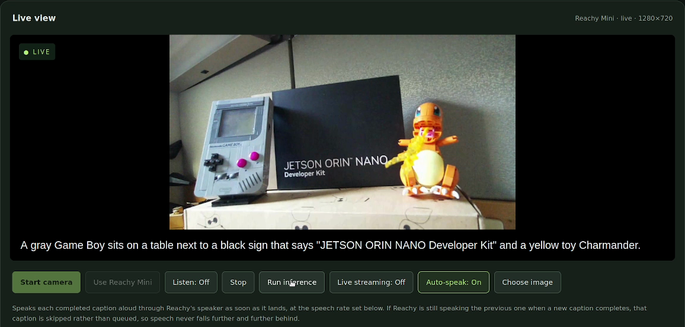

# Live Vision With Cosmos3-Edge on Jetson


Live Vision is a demonstration that popular, small model vision language models such as [Cosmos3-Edge](https://huggingface.co/nvidia/Cosmos3-Edge) can be run in real time, on a tabletop, with headroom to spare for user applications.  This demonstration runs ~2 frames per second, with ~60% of RAM usage on our smallest Jetson device, the [Jetson Orin Nano Super 8GB](https://www.nvidia.com/en-in/autonomous-machines/embedded-systems/jetson-orin/nano-super-developer-kit/), retailing at the time of publishing this demo, $399 USD.

Although previous demonstrations have been done with a [nearly identical setup](https://www.jetson-ai-lab.com/tutorials/reachy-mini-jetson-assistant/) by Jetson AI lab, this entire demo can be completed by **a single prompt in an agent coding harness**.

Alex Sotelo presented this original demo during [**A New Way to Build Edge AI: Agentic Development on NVIDIA Jetson**](https://www.youtube.com/live/OF_ryVZmB3w?t=1927) on **September 30, 2026, at 9:00 a.m. Pacific**. One initial agentic goal produced the first working FP16 baseline; optimization, INT4 integration, interface improvements and accuracy fixes followed. The images here come from Alex's October 2 follow-up demo.

**Choose your route:** [Build from scratch with Astra (or your favorite coding agent)](#build-with-astra) · [Run the single shot, packaged demo - Agent or human configured](#run-the-packaged-demo)

[Prerequisites](#what-you-need) · [First caption](#try-your-first-caption) · [Reachy Mini](#optional-reachy-mini) · [Inference API](#use-the-inference-api) · [Troubleshooting](docs/troubleshooting.md) · [Contributions](#contributions)

## What you need

| Item | Supported starting point |
|---|---|
| Jetson | Orin Nano Super developer kit with 8 GB RAM, power supply, and a booting **JetPack 7.2.1 / L4T 39.2.1** installation. |
| Storage | A **64 GB or larger SD card** is recommended for the source build. Setup checks available space for dependencies and intermediate model files. |
| Network | Internet access for installation; a trusted local network between the Jetson and your browser. Start with Ethernet. |
| Setup computer | Git, Bash, SSH, SCP and tar. The default source build runs on the Jetson; your computer does not need CUDA, TensorRT or a GPU. |
| Camera | A webcam or smartphone camera accessible to a browser over HTTPS. An optional Reachy Mini supplies another camera through its bridge. |

Keep a compatible JetPack installation. If the board needs an operating system first, follow the [supported Mac SD preparation guide](docs/jetpack-sd-mac.md) and [first-boot checks](docs/first-boot-recovery.md), then return here.

The source installer provides **CUDA 13.2**, uses **TensorRT 10.16.2.10** for matching engines, and builds the pinned **TensorRT-Edge-LLM 0.11.0** revision. The [runtime compatibility record](container/runtime-spec.json) lists exact identities. Model inference runs locally on the Jetson; a coding agent may use a remote service while helping you build it.

<a id="build-with-astra"></a>

## Build with Astra (or your favorite coding agent)

Give the agent an outcome, the repository and a way to prove it worked. In the demonstrated Astra/Codex workflow, `/goal` starts the goal-directed task; other tools may use a different command.

Open this repository in your Astra workspace and adapt the following goal to your device:


```text
Prompt:
/goal install jetpack on the connected Jetson Orin Nano on the USB-C port.  When that's done, I want a performant and working version of Cosmos3-Edge (https://huggingface.co/nvidia/Cosmos3-Edge), using TRT-Edge-LLM as the backend (https://github.com/NVIDIA/TensorRT-Edge-LLM) and a streaming web UI like (https://github.com/nvidia-ai-iot/live-vlm-webui).  Once you have signs of life, optimize for the lowest possible VRAM footprint with the fastest latency. Explore acceleration techniques such as CuTeDSL (https://github.com/nvidia/cutlass). On a live working setup on Orin, we have seen demonstrated RAM loads of 4.63GB and TTFT of 209 ms, with an average latency of 509 ms. Attempt to get within 10% of those performance parameters and RAM load. When done, serve the website, test fully working inference and serve me the URL.
```

What Astra (or your favorite coding agent) does:

- Sets up your NVIDIA Orin device, handles issues automatically or escalates for human help
- Combines Cosmos3-Edge, our open weight model, with open source optimizations, so it will fit on your Orin’s memory footprint
- Tests everything end-to-end, and orchestrates everything on your system to work (cameras, WiFi / Network, robot, Orin)

You will need to monitor while the agent sets up the system.  Using the installer, you will not need a GPU on the host device for setup.  Whatever requires a GPU will be done on the Orin itself.

Let the agent inspect the board, read [AGENTS.md](AGENTS.md), explain the setup and run the installer. Enter credentials in its local terminal when needed. Once the UI appears, use [the first-caption walkthrough](#try-your-first-caption) together: verify the words match known scenes, change what the camera sees and check that captions change too.

After the initial bringup works, ask the agent to measure the same images, prompts and settings before changing anything. The [source guide](docs/source-installation.md) explains engine rebuilding and the optional Linux-host export path.

## Run the packaged demo

To build a container from source and package your engine separately, see the [container guide](container/README.md). Prebuilt runtime images and engine bundles are not provided.

To run the demo today, use the automated **source build** below. It downloads the pinned model, builds a memory-efficient Cosmos3-Edge quantization on the Jetson, configures your Orin's web server and starts the web services. **Estimated time to build is over 1 hour**; setup resumes completed stages after an interruption.

### 1. Connect your Jetson

Complete first boot, and follow the steps to confirm SSH access to the intended Jetson board and keep it connected to Ethernet. Replace `jetson-user@orin-ip` below with its verified account and address. Ensure you have the password ready for the terminal if the Jetson is password protected. A Reachy Mini is optional, but the script and web interface can discover one connected to the same network as the Orin, and control it directly from the webpage.

### 2. Start setup from your computer

Clone the demo:

```bash
git clone --branch feat/live-vision-cosmos-demo https://github.com/NVIDIA-AI-IOT/live-vision-cosmos-demo.git
cd live-vision-cosmos-demo
bash scripts/bootstrap.sh jetson-user@orin-ip
```

Enter the Jetson's SSH and sudo passwords when prompted. The installer offers Reachy discovery, a manual address or **Skip**; choosing Skip still gives you browser-camera captions. No Hugging Face token is required for the pinned model revision. For source-install details and recovery, see [the installation guide](docs/source-installation.md#advanced-source-installation).

### 3. Open Live Vision

Open the HTTPS URL printed by setup, normally `https://<orin-ip>:8443/`, on the computer or phone whose camera you want to use. Trust the certificate from your own Jetson (by clicking the "Advanced" and "Proceed Anyway" when it indicates the link you provide is unsafe), grant camera permission and continue below.  Since this is fully local, you can ignore the certificate warnings and run from any device connected with a camera.

The [troubleshooting guide](docs/troubleshooting.md) covers camera permissions, setup recovery and caption failures.

## Try your first caption

Click **Start camera**. Leave **Live streaming: On**, hold an object steadily in view and read the caption as it arrives. Since the caption takes single frames, ensure the camera feed is stable, the camera is stationary, and has proper lighting for more accurate captioning.


Use **Choose image** for a repeatable test or turn live streaming off and click **Run inference** for one request. If a description is wrong, improve the framing, hold still and retry with a known image.

## Optional Reachy Mini

With the source installation, open **Reachy Mini setup** to discover or enter a verified robot address, then select **Use Reachy Mini**. The setup checks the robot before saving it and leaves model inference running. [Reachy setup](docs/reachy-setup.md) explains discovery, changing robots and skipping this extension.




The source installation prepares Flite speech with the built-in SLT English voice and the camera bridge. After connecting your robot, try **Auto-speak** to hear captions and adjust the speech-rate control. Flite generates each utterance locally; no separate voice download is needed. The current fixed-engine container does **not** include robot camera bridging or speech; use the source path for those features. No Home Assistant installation is required.

## Use the inference API

Live Vision preserves `/health/ready` and `/v1/chat/completions`. Its UI proxy accepts one JPEG and one text prompt per streaming request. With `scene.jpg` in your current directory, run this example **on the Jetson** against the local UI listener after source setup:

```bash
curl http://127.0.0.1:8091/health/ready

python3 - <<'PY' | curl --no-buffer \
  http://127.0.0.1:8091/v1/chat/completions \
  -H 'Content-Type: application/json' --data-binary @-
import base64, json
from pathlib import Path
image = base64.b64encode(Path('scene.jpg').read_bytes()).decode('ascii')
print(json.dumps({
    'model': 'nvidia/Cosmos3-Edge', 'stream': True,
    'temperature': 0, 'max_tokens': 64,
    'messages': [{'role': 'user', 'content': [
        {'type': 'text', 'text': 'Describe the main object in this image.'},
        {'type': 'image_url', 'image_url': {'url': 'data:image/jpeg;base64,' + image}}
    ]}]
}))
PY
```

Use a small JPEG so the encoded JSON request stays below 2 MB. Read the returned text as well as the readiness result. For access from another computer, use HTTPS on port 8443 with a certificate matching the Jetson's hostname or address. For container deployment, see [the runtime API guide](container/README.md#inference-api).

<a id="updates-and-contributions"></a>

## Contributions

For deeper work, start with the [source and engineering guide](docs/source-installation.md), [troubleshooting](docs/troubleshooting.md). Contributions use the process and DCO sign-off in [CONTRIBUTING.md](CONTRIBUTING.md).

The application's code is licensed under [Apache-2.0](LICENSE.md). The copied Pollen Robotics files in [`reachy/reachy_stream/`](reachy/reachy_stream/) retain their [Apache-2.0 license and copyright](reachy/reachy_stream/LICENSE). The `licenses/` directory preserves [Flite's permissive CMU and component-specific terms](licenses/Flite-COPYING) for the optional source-built speech dependency. [NOTICE.md](NOTICE.md) records third-party and media attribution; model weights, engines and other dependencies have their own terms and are not included here. [SOURCE.json](SOURCE.json) identifies the application source and copied third-party files.
